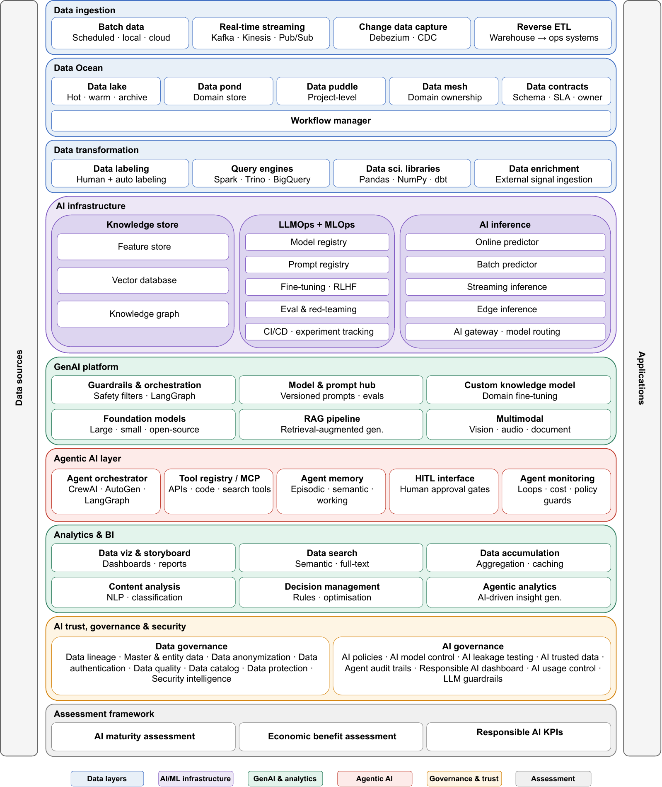
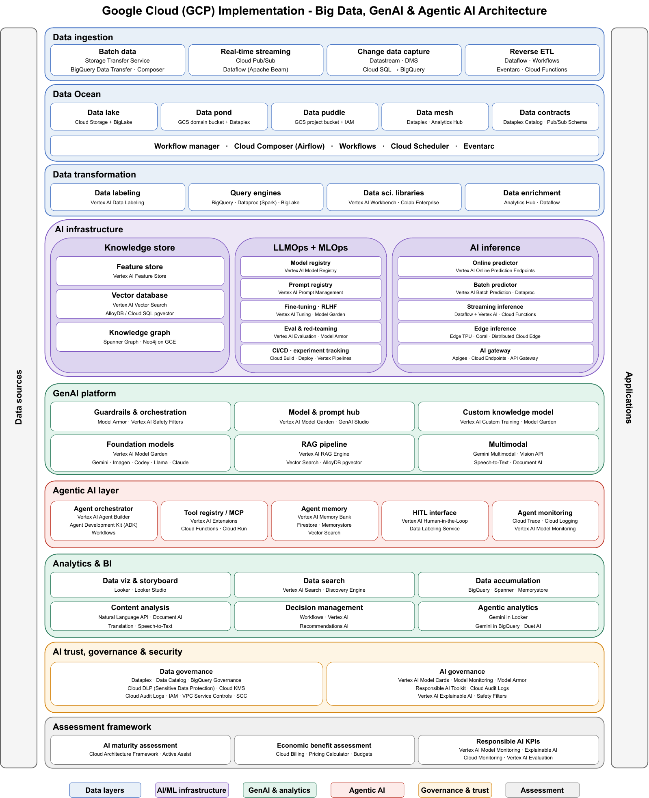
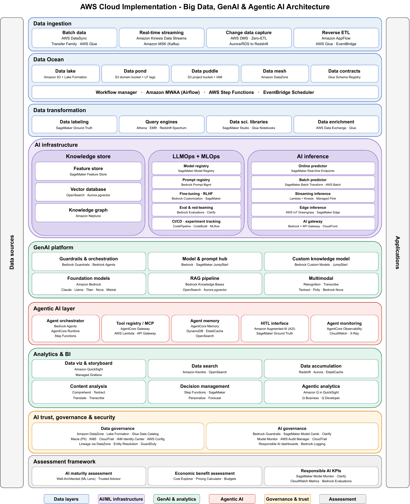
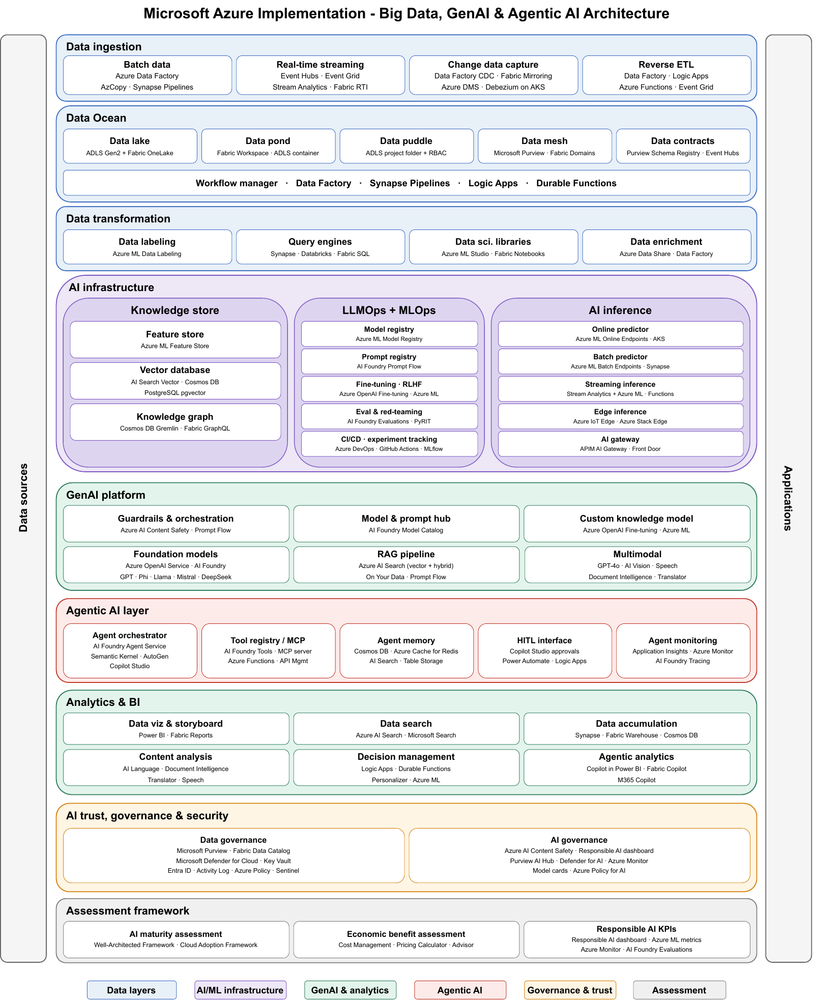

# Big Data Architecture for Large Organizations — Companion Repository

Companion repository for the paper **_"Big Data Architecture for Large Organizations: Incorporating Generative AI and Agentic AI"_** by Fathima Nuzla Ismail, Shanika Amarasoma, and Abira Sengupta.

It hosts the full-resolution **functional architecture diagrams**: a cloud-agnostic reference design and its realisation on the three major cloud platforms — Google Cloud, Amazon Web Services (AWS), and Microsoft Azure. The paper embeds the cloud-agnostic diagram and refers readers here for the per-cloud implementations.

All four diagrams are published as vector PDFs. They use an IEEE print-friendly style (black text for grayscale legibility, colour-coded layer families).

---

## Diagrams

### 1. Functional Architecture (cloud-agnostic)
The layered reference architecture, independent of any cloud provider.



📄 Vector PDF: [`Detailed_Functional_Diagram.pdf`](Detailed_Functional_Diagram.pdf)

### 2. Google Cloud (GCP) Implementation


📄 Vector PDF: [`functional_diagram-GCP.pdf`](functional_diagram-GCP.pdf)

### 3. Amazon Web Services (AWS) Implementation


📄 Vector PDF: [`functional_diagram-AWS.pdf`](functional_diagram-AWS.pdf)

### 4. Microsoft Azure Implementation


📄 Vector PDF: [`functional_diagram-azure.pdf`](functional_diagram-azure.pdf)

---

## Repository contents

| File | Description |
|------|-------------|
| [`Detailed_Functional_Diagram.pdf`](Detailed_Functional_Diagram.pdf) | Cloud-agnostic functional architecture (paper Fig. 1) |
| [`functional_diagram-GCP.pdf`](functional_diagram-GCP.pdf) | Google Cloud realisation |
| [`functional_diagram-AWS.pdf`](functional_diagram-AWS.pdf) | AWS realisation |
| [`functional_diagram-azure.pdf`](functional_diagram-azure.pdf) | Microsoft Azure realisation |
| [`previews/`](previews) | PNG previews used in this README |

---

## Architecture at a glance

The design keeps a layered structure and adds first-class support for Generative and Agentic AI:

- **Data ingestion** — batch, real-time streaming, change data capture (CDC), reverse ETL
- **Data Ocean** — Data Puddle → Pond → Lake → Ocean, with Data Mesh domain ownership and **Data Contracts**
- **Data transformation** — labelling, query engines, data-science libraries, enrichment
- **AI infrastructure** — Knowledge Store (feature store, vector database, knowledge graph), unified **LLMOps + MLOps**, and AI inference with a multi-provider **AI Gateway**
- **GenAI platform** — guardrails & orchestration, model/prompt hub, RAG pipeline, multimodal, foundation models
- **Agentic AI layer** — agent orchestrator, **Model Context Protocol (MCP)** tool registry, agent memory, Human-in-the-Loop (HITL) interface, agent monitoring
- **Analytics & BI** — dashboards, search, agentic analytics
- **AI trust, governance & security** — data governance + AI governance (audit trails, responsible-AI dashboard, prompt-injection detection)
- **Assessment framework** — AI maturity, economic benefit, and responsible-AI KPIs

---

## Citation

If you use these diagrams or the architecture, please cite the paper. The predecessor design was published as:

```bibtex
@inproceedings{IsmailBigData2025,
  author    = {Ismail, Fathima Nuzla and Sengupta, Abira and Amarasoma, Shanika},
  title     = {Big Data Architecture for Large Organizations},
  booktitle = {2025 10th International Conference on Big Data Analytics (ICBDA)},
  pages     = {27--32},
  year      = {2025},
  doi       = {10.1109/ICBDA65366.2025.11211062}
}
```

The extended version — *Big Data Architecture for Large Organizations: Incorporating Generative AI and Agentic AI* — introduces the Agentic AI layer, the consolidated AI infrastructure tier, Data Contracts, and the scenario-based evaluation.

---

## License / reuse

These diagrams are provided for academic and educational use. Please attribute the paper and authors when reusing or adapting them.
